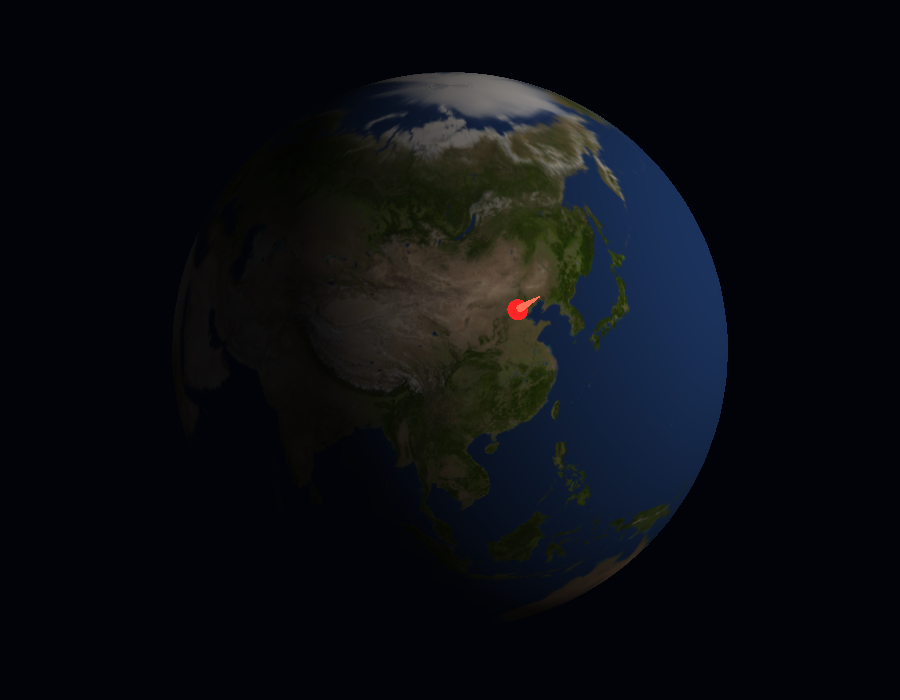

# 手势识别交互 · Hand Gesture Playground

用普通摄像头隔空操作电脑的一组小应用。四个玩法共用一个识别层：**MediaPipe 取 21 个手部关键点 → 几何规则判姿态 → 各应用自己决定姿态对应什么动作**。

识别层不依赖 PyQt、不依赖 OpenGL、不依赖 pyautogui。加新玩法不用碰识别代码，改判定规则只改一处。



| 应用 | 手势 | 技术栈 |
|---|---|---|
| **花开** | 张掌 → 花朵缓慢盛开，握拳 → 收拢，手移出画面保持不变 | OpenCV + 帧序列贴图 |
| **手势作画** | 只伸食指作画，捏合选中并拖动笔画，张掌让笔画爆成粒子 | OpenCV + 矢量笔画 + 粒子 |
| **双手地球** | 左手捏合拖动旋转，右手张开程度控制推拉，双手同时捏合切换中国地图 | PyQt6 + OpenGL |
| **隔空鼠标** | 张掌移动光标，捏合单击，握拳拖拽，两指上下滚动 | OpenCV + pyautogui |

## 快速开始

要求：**Windows + Python 3.12 + 一个能用的摄像头**。

```bash
git clone https://github.com/<your-name>/hand-gesture-playground.git
cd hand-gesture-playground

py -3.12 -m pip install -r requirements.txt

# 下载手部模型（7.5MB，带 sha256 校验）
py -3.12 tools/fetch_assets.py
```

然后双击根目录的启动脚本：

```
启动花开.bat          启动手势作画.bat
启动双手地球.bat      启动隔空鼠标.bat
```

> 摄像头同一时刻只能被一个进程占用，四个应用不要同时开。
> 隔空鼠标会真的接管鼠标指针，第一次试建议把手放低一点再张掌。

### 关于素材

仓库**不收录**两个大文件，`tools/fetch_assets.py` 会说明缺什么：

| 文件 | 体积 | 获取方式 | 缺失时的影响 |
|---|---|---|---|
| `assets/hand_landmarker.task` | 7.5 MB | 脚本自动从 MediaPipe 官方地址下载 | 所有应用无法启动（会打印提示并退出） |
| `projects/flower_bloom/assets/rose_frames.npz` | 19.5 MB | 需自备玫瑰延时视频生成 | 仅「花开」退化为程序化花型，其余三个不受影响 |

花帧是从一段玫瑰延时视频里按固定裁剪框抽的 120 帧，源视频不在仓库内也不适合随仓库分发。想还原真实花朵：

```bash
set ROSE_VIDEO=D:\path\to\your\rose.mp4
py -3.12 projects/flower_bloom/tools/extract_rose_frames.py
```

裁剪框 `CROP`、取帧区间、输出帧数都在脚本顶部，换视频时按画面比例调整。

## 目录结构

```
hand-gesture-playground/
├─ gesture_core/            唯一识别层，四个应用共用
│  ├─ tracker.py            HandTracker：摄像头线程 + MediaPipe 推理 + 骨架绘制
│  └─ rules.py              纯规则：手指伸直、捏合度、掌心、张开度、防抖工具
├─ projects/
│  ├─ flower_bloom/         花开
│  ├─ hand_paint/           手势作画
│  ├─ hand_3d/              双手地球 + 中国地图球面贴片
│  └─ air_mouse/            隔空鼠标
├─ assets/                  手部模型（不进仓库，脚本下载）
├─ textures/                地球贴图 day4k / clouds / lights
├─ tools/fetch_assets.py    素材获取与校验
├─ tests/                   不接摄像头也能跑的自检
└─ 启动*.bat                四个启动脚本（固定使用 py -3.12）
```

## 识别层怎么用

自己的前端 20 行就能接上：

```python
import sys
from pathlib import Path

ROOT = Path(__file__).resolve().parents[1]
sys.path.insert(0, str(ROOT))

from gesture_core import HandTracker, classify_gesture, anchor

def on_hands(hands, frame):
    if not hands:
        return
    lm = hands[0]                                # 21 个归一化关键点
    print(classify_gesture(lm), anchor(lm))      # 手势名、食指尖坐标

det = HandTracker(ROOT / "assets" / "hand_landmarker.task", on_hands)
det.start()
input("回车退出\n")
det.stop(); det.join(2000)
```

**`HandTracker` 参数**

| 参数 | 说明 |
|---|---|
| `on_hands` | `callback(hands, frame)`，`hands` 为 0~2 只手的 landmarks 列表 |
| `num_hands` | 1 或 2，只要单手设 1 更省 CPU |
| `cam_size` | `(宽, 高)`，默认 `(640, 480)`，卡顿可降 |
| `infer_interval` | 两次推理最小间隔（秒），0.016≈60fps，0.033≈30fps |
| `mirror` | 自拍镜像。要做「手往右、光标往右」必须开 |
| `draw` | 是否在回调帧上画骨架，不看预览就关掉省 CPU |
| `cam_fps` | 向摄像头请求的帧率，`None` 表示不设置 |

属性：`last_infer_ms`（单次推理耗时）、`fps`（处理帧率）、`error`（失败原因）。

**`rules` 里可直接用的函数**

`fingers_up` `count_up` `is_open` `pinch_ratio` `palm_center` `hand_center_x` `anchor` `openness` `classify_gesture`，以及 `EMA` / `ClickDebounce` / `ModeHold` 三个时序工具。

## 手感调参

统一在 `gesture_core`：

- `rules.STRAIGHT_RATIO = 1.15` — 手指「伸直」的判定线，误判多就调高
- `classify_gesture(pinch_threshold)` — 默认 0.28，误触多调大、捏不准调小
- `HandTracker(infer_interval)` — 识别频率，越低越跟手但越吃 CPU
- `HandTracker(cam_size)` — 采集分辨率，卡顿就降

各应用的手感参数写在各自文件顶部：

- `air_mouse.py` — `ALPHA` 光标平滑、ROI 映射区域、`SCROLL_SENS`
- `paint_app.py` — `HIT_RADIUS` 命中半径、`EMA_ALPHA` 指尖平滑、`MODE_HOLD` 防抖帧数
- `flower_engine.py` — `open_speed` / `close_speed`
- `hand_3d/main.py` — `CAM_DIST_MIN/MAX`、`ZOOM_SPEED`、`MAP_SCALE` 等地图像素

## 自检（不需要摄像头）

```bash
py -3.12 tests/compare_rules.py     # 35 组合成手型 × 4 套规则，与基线逐值比对
py -3.12 tests/test_wiring.py       # 应用可导入、检测器参数与回调签名
py -3.12 tests/test_globe_modes.py  # 地球初始姿态、大头针朝向、地图模式隔离
```

`tests/synth_hands.py` 用几何方式造出张开/握拳/捏合/单食指等手型，伸直与蜷曲的比值刚好跨过 1.15 判定线，所以能真实覆盖分支。改了规则跑一次 `compare_rules`，就知道有没有把别的应用带坏。

地球相关的验证工具在 `projects/hand_3d/`：

| 脚本 | 作用 |
|---|---|
| `tools_calibrate_tex.py` | 标定 `gluSphere` 的贴图坐标（北极在 +Z，不是 +Y） |
| `tools_verify_mapping.py` | 离屏渲染后逐像素比对贴图取样，确认经纬度换算正确 |
| `tools_check_patch.py` | 四个朝向差分统计，证明中国地图贴在球面上而非浮在屏幕前 |
| `tools_preview_globe.py` | 把任意视角渲染成 PNG，调大头针位置和初始朝向用 |

## 几个踩过的坑

写在这里，因为下次还会踩：

- **`gluSphere` 的北极在 +Z 轴**，不是常规的 +Y。按 `y = cos(lat)` 写经纬度换算会让大头针飞到北太平洋。正确式子是 `dir = (sinλ·sinφ, −cosλ·sinφ, cosφ)`。
- **`load_texture()` 统一做了 `cv2.flip(img, 0)`**（OpenCV 自上而下 → OpenGL 自下而上），所以纹理坐标 `t=0` 对应原图底边。手写 `glTexCoord2f` 的平面四边形时把 `t=1` 配给屏幕下方，整张图就南北颠倒。
- **OpenGL 状态是全局的**。插在中间的一段代码如果 `glDisable(GL_BLEND)` 后没还原，后面的云层就会以不透明纯白铺满整个球。原代码靠上一步「凑巧」开着混合，这种隐式依赖一经插入就崩。
- **Windows 中文路径下 mediapipe 原生层打不开模型**，`tracker.py` 改成读字节再喂 `BaseOptions`，不要改回传路径。
- **`self._stop = threading.Event()` 会覆盖 `threading.Thread._stop()`**，导致线程结束后 `join()` 抛 `TypeError`。改用 `_stop_event`。

## 已知限制

1. 规则法只能认粗粒度姿态，比心、数字、字母这类细动作认不了；要认就得加规则或另接分类模型。
2. 光线差、手离摄像头过远/过近时识别率下降。
3. 双手交互对摄像头角度和背景有要求，两只手别互相遮挡。
4. 打包成 exe 时要用 PyInstaller 的 `--add-data` 把 `assets` 和 `textures` 一起打进去。
5. 目前是单进程本地运行。要做网页桥接，在 tracker 回调上加一层 WebSocket 即可。

## 素材来源

- 手部关键点模型：[MediaPipe Hand Landmarker](https://ai.google.dev/edge/mediapipe/solutions/vision/hand_landmarker)（Apache-2.0），由 `tools/fetch_assets.py` 从官方地址下载
- 地球贴图：NASA Blue Marble 系列（公有领域）
- 中国疆域轮廓：`projects/hand_3d/textures/china.json`，由 `tools_make_china.py` 渲染成带透明通道的等距圆柱投影贴图
- 玫瑰帧序列：自备延时视频抽取，脚本见 `projects/flower_bloom/tools/`
